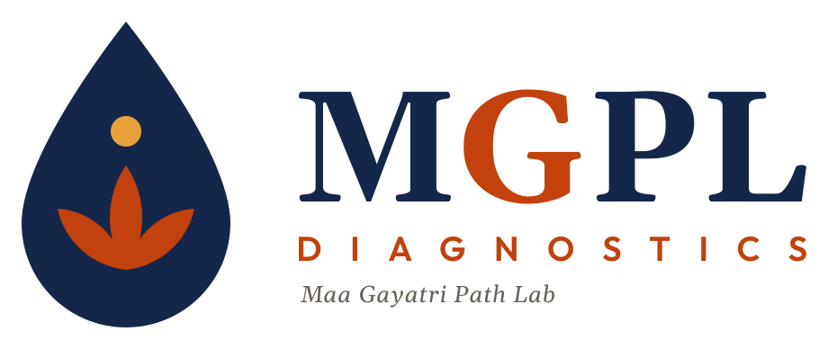

<div align="center">



# MGPL Diagnostics website

**The public website of Maa Gayatri Path Lab, Arang, Raipur.**
A single page with a living 3D lab, the full test catalogue with prices, home sample collection,
report download and one-tap booking.

    

</div>

## Sections

| Section | Component |
| --- | --- |
| Hero with the 3D "living lab" background | `Hero`, `three/BackgroundScene` |
| Services | `ServicesGrid` |
| Test catalogue by category, with prices and turnaround | `TestCategories` |
| Home sample collection | `HomeCollection` |
| Download a report | `ReportDownload` |
| Doctors and trust signals | `DoctorTrust`, `WhyChoose` |
| Testimonials, FAQ, final call to action | `Testimonials`, `FAQ`, `FinalCTA` |
| Book a test (dialog, from every section) | `BookTestDialog`, `ui/BookButton` |

## Change the content, not the code

All copy, prices and contact details live in **`lib/config/*.json`**:

| File | Holds |
| --- | --- |
| `brand.json` | name, tagline, colours |
| `contact.json` | phone, WhatsApp, email, address, hours |
| `catalogue.json` | test categories, tests, prices (₹), turnaround, preparation |
| `services.json` · `home-collection.json` | services and home-collection details |
| `doctors.json` · `testimonials.json` · `metrics.json` · `why-choose.json` | trust sections |
| `faq.json` · `hero.json` · `nav.json` · `footer.json` | page text and navigation |

`lib/config.ts` loads and types them (`lib/types.ts`). Components only read from it.

## The 3D scene

`components/three/` holds the scene: `engine.ts` (renderer and loop), `objects.ts` (lab objects) and
`materials.ts` (brand colours applied at runtime). Scrolling drives it through GSAP (`lib/gsap.ts`,
`lib/scroll-store.ts`). Models are in `public/models`. They are optimised copies of **CC-BY 3.0 / CC0**
works, credited in `lib/model-credits.ts` and shown in the footer. Keep those credits when adding or
replacing a model.

## Run

```bash
npm install
npm run dev      # http://localhost:3000
npm run build && npm start
npm run lint
npm run llms     # regenerate llms-full.txt after changes
```

> This project uses Next.js 16, which changes APIs and conventions. Read `node_modules/next/dist/docs/`
> before writing code (see [AGENTS.md](AGENTS.md)).

## Project map

```
app/              layout, page, global styles, icons
components/       page sections, motion helpers (SmoothScroll, Tilt3D), ui (BookButton, Icon, SectionHeading)
components/three/ the 3D living-lab scene
context/          BookTestContext (booking dialog state)
lib/config/       all site content as JSON
lib/              config loader and types, GSAP setup, scroll store, model credits
public/           logos, 3D models
logos/            logo concepts and exports
```

## Part of MGPL Diagnostics

The lab's reports, invoices and data run on the public kits in
[github.com/mgpl-diagnostics](https://github.com/mgpl-diagnostics). AI tools: start at
[llms.txt](llms.txt) or [llms-full.txt](llms-full.txt).

## Licence

Code and content © MGPL Diagnostics (Maa Gayatri Path Lab). All rights reserved. 3D models keep their
own licences (see `lib/model-credits.ts`).
